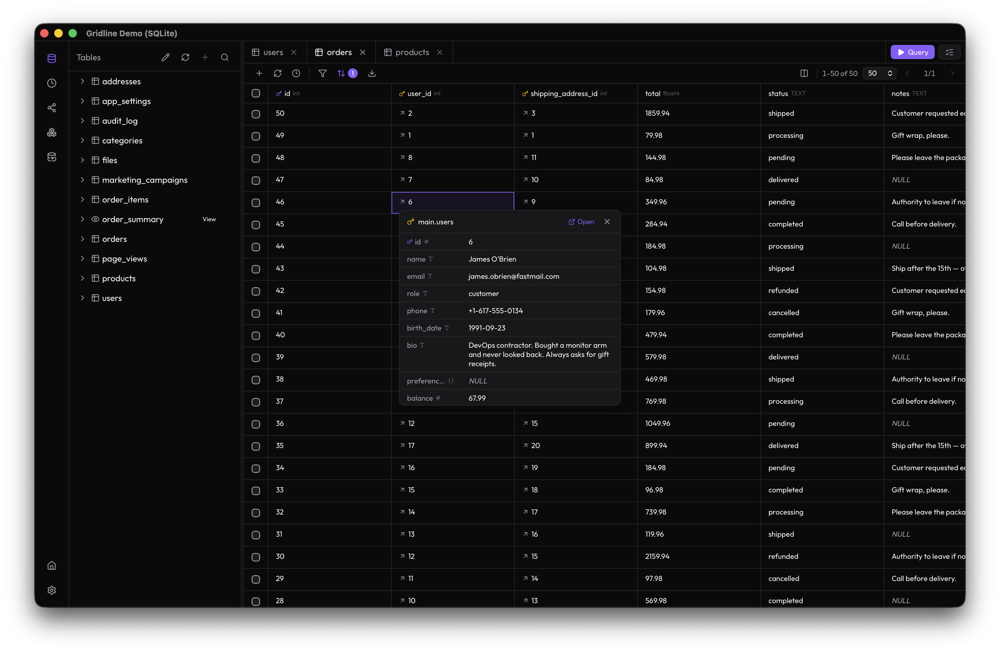
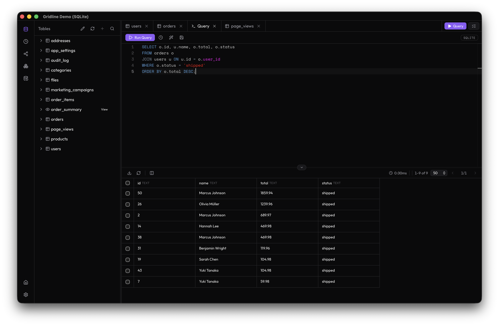
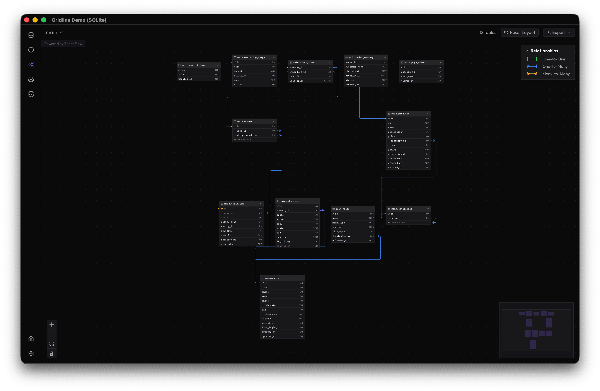
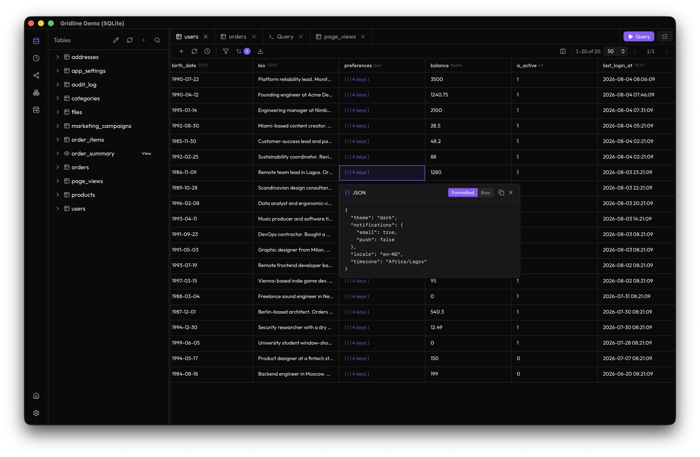
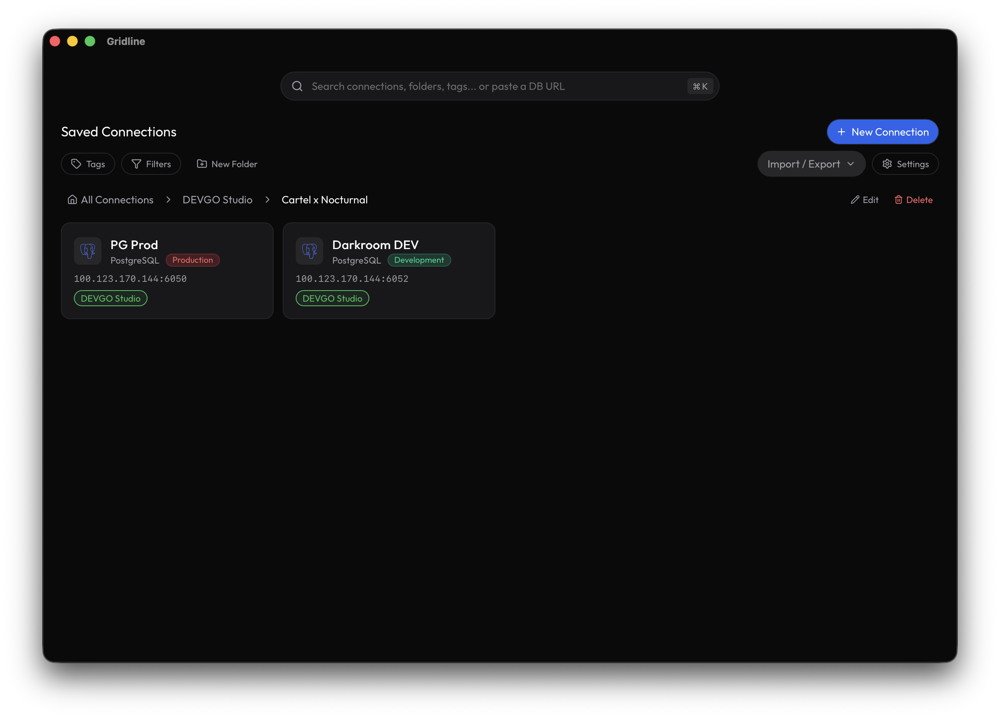

<p align="center">
  
</p>
<p>
  <sub><b>Data Grid & FK Preview</b> — browse 50+ real demo orders and inspect related rows in one click.</sub>
</p>

<h1>Gridline</h1>

<p>
  <i>A lightweight, open-source database GUI for PostgreSQL, MySQL, SQLite, and Redis.</i><br />
  Unlimited connections, tabs, and saved queries — with first-class backup, restore, and DB-to-DB sync for PostgreSQL, MySQL, and SQLite.
</p>

<p>
  <a href="https://tauri.app/"></a>
  <a href="https://www.rust-lang.org/"></a>
  <a href="https://react.dev/"></a>
  <a href="https://www.typescriptlang.org/"></a>
  <a href="./LICENSE"></a>
  <a href="https://github.com/AdrianBonpin/gridline"></a>
</p>

<p>
  <a href="https://github.com/AdrianBonpin/gridline/releases"></a>
  <a href="https://github.com/AdrianBonpin/gridline/issues/new"></a>
</p>

---

## Download

Grab the installer for your OS from the [latest release](https://github.com/AdrianBonpin/gridline/releases/latest) — the links below point at the current release (**v0.9.2**):

| OS                           | Architecture                 | Download                                                                                                                             |
| :--------------------------- | :--------------------------- | :----------------------------------------------------------------------------------------------------------------------------------- |
| **macOS**                    | Apple Silicon (M1/M2/M3/M4…) | [Gridline_0.9.2_aarch64.dmg](https://github.com/AdrianBonpin/gridline/releases/download/v0.9.2/Gridline_0.9.2_aarch64.dmg)         |
| **macOS**                    | Intel                        | [Gridline_0.9.2_x64.dmg](https://github.com/AdrianBonpin/gridline/releases/download/v0.9.2/Gridline_0.9.2_x64.dmg)                 |
| **Windows**                  | x64                          | [Gridline_0.9.2_x64-setup.exe](https://github.com/AdrianBonpin/gridline/releases/download/v0.9.2/Gridline_0.9.2_x64-setup.exe)     |
| **Debian / Ubuntu**          | amd64                        | [Gridline_0.9.2_amd64.deb](https://github.com/AdrianBonpin/gridline/releases/download/v0.9.2/Gridline_0.9.2_amd64.deb)             |
| **Fedora / RHEL / openSUSE** | x86_64                       | [Gridline-0.9.2-1.x86_64.rpm](https://github.com/AdrianBonpin/gridline/releases/download/v0.9.2/Gridline-0.9.2-1.x86_64.rpm)       |
| **Other Linux**              | x86_64                       | [Gridline_0.9.2_amd64.AppImage](https://github.com/AdrianBonpin/gridline/releases/download/v0.9.2/Gridline_0.9.2_amd64.AppImage)   |

> **Linux is built and tested on Ubuntu 22.04 x86_64 only.** The `.deb`, `.rpm` and `.AppImage` are three packagings of that one verified build — not a per-distribution certification. See [Linux support and troubleshooting](#linux-support-and-troubleshooting) for exactly what is and is not covered, and for the AppImage black-window diagnostic checklist ([issue #62](https://github.com/AdrianBonpin/gridline/issues/62), open).

**macOS via Homebrew** (recommended for Mac users):

```bash
# one-time setup (the tap is hosted on GitHub):
brew tap AdrianBonpin/gridline https://github.com/AdrianBonpin/homebrew-gridline.git
brew trust adrianbonpin/gridline

# install / upgrade:
brew install --cask gridline
```

The cask installs the app directly. The DMGs are Developer-ID signed and notarized, so macOS trusts them on first launch — no `xattr` or "Open Anyway" step needed.

> **macOS first launch:** Gridline is Developer-ID signed and notarized, so macOS opens it without a Gatekeeper prompt. Not sure if your Mac is Intel or Apple Silicon? See [Which file should I download?](#which-file-should-i-download) below.

<!--
  MAINTENANCE: These links are STATIC (versioned) — they point at the v0.9.2
  release assets, not at a moving "latest" target. On every new release,
  update BOTH tables here (Download + Which file should I download?) to the
  new version's asset names, which are tauri-action's default naming:
    Gridline_<version>_aarch64.dmg / _x64.dmg / _x64-setup.exe /
    _amd64.deb / _amd64.AppImage  and  Gridline-<version>-1.x86_64.rpm
  The .msi (Gridline_<version>_x64_en-US.msi) is not linked below.
-->

---

## What is Gridline?

Gridline is a modern, open-source database GUI client built with [Tauri 2.0](https://tauri.app), Rust, and React. It is lightweight by design (~40 MB baseline), powerful by default, and free from the paywalls that limit commercial alternatives.

- **No caps** on connections, tabs, or saved queries.
- **Deep PostgreSQL tooling** — visual `pg_dump`, `pg_restore`, and DB-to-DB sync.
- **Backup, restore & sync for every database** — PostgreSQL, MySQL (`mysqldump` / bundled MariaDB clients), and SQLite (`.dump`), with direct DB-to-DB sync between live connections.
- **Excel export** — CSV, JSON, SQL, Markdown, and `.xlsx` from any data grid.
- **Cancel long-running queries** — a per-connection cancel button instead of waiting it out or killing the app.
- **SQLite table editor** — the visual Create Table / Edit Table flow now works on SQLite too (`INTEGER PRIMARY KEY AUTOINCREMENT` instead of `serial`).
- **Full MySQL + SQLite browsing** — connect, browse, query, and edit MySQL and SQLite the same way you do PostgreSQL.
- **Full object explorer** — not just tables, but functions, triggers, sequences, enums, extensions, materialized views, and procedures.
- **Interactive ER diagram** — explore relationships visually with crow's-foot cardinality notation.
- **Production-safe editing** — stage INSERT/UPDATE/DELETE changes, review the generated SQL, then commit all at once.

The app ships with a built-in **Gridline Demo (SQLite)** database, so you can explore every feature immediately without setting up a server.

---

## Who is it for?

Gridline is built for developers and small teams who manage multiple database environments:

- **Full-stack developers** switching between local, staging, and production databases.
- **Platform / DBAs** who need `pg_dump`, `pg_restore`, and sync tooling in a native UI.
- **Teams that want native speed** without Electron bloat or seat licenses.

---

## Recent Changes

<details>
<summary>View the full changelog</summary>

- **v0.9.2** — **SSH host keys are verified before your credentials are sent**: a known host verifies silently, an unknown host asks you to accept its fingerprint once and remembers it, a changed key fails closed with both fingerprints, and replacing stale trust is a separate deliberate action rather than an override on the error path. **TLS fails closed** — an unrecognised mode is an error at save, import and connect instead of a silent plaintext connection, and certificate verification through an SSH tunnel now validates the real database hostname rather than the loopback endpoint. **File access goes through File Grants** — backup output, restore input, streamed exports, CSV/JSON imports, settings import/export and connection transfer each consume a backend-issued grant that expires after five minutes and is used up by one job, so a path the interface merely displays authorises nothing, and a failed write publishes no partial file over an existing one. **A SQLite table rebuild is one transaction or no change at all** and either reproduces the table's `CHECK`s, constraints, indexes, triggers, generated columns, table options and sequence state or refuses in the editor before touching anything; values move by Column Identity, so a reorder shifts no data and adding a column is never read as a rename. **An edit or delete changes exactly the row you selected or nothing** — Row Identity covers every primary-key column, the write commits only when one row matched, and the original value of the edited column is checked so a concurrent change is reported as a conflict instead of being overwritten; pending work stays scoped to the Change Origin it was staged against. **Restores and dumps are honest about failure** — PostgreSQL restores run in a single transaction when the dump allows it and otherwise require you to accept the stated partial-application risk, a lock-waiting restore is stopped after 60 seconds of continuous waiting while a large progressing one is never killed, MySQL restores understand the dialect's escapes and clean only the objects the dump recreates, and a SQLite dump is read from one snapshot and is either lossless or refused. **Every place SQL can be sent from applies the same rules** — run, re-run, history/saved, pagination, refresh and export share one guard, classification reads the whole script and fails closed on an unknown verb, export is validated and executed read-only in the backend, a confirmation is bound to its request, and each accepted request executes once. **Long-running work is cancellable** with process-tree termination on cancel or quit, one connection's slow query no longer blocks the rest of the app, and a disconnect closes the pool and tunnel together while a failed reconnect keeps the working session. **Releases run through one pipeline with least trust** — pinned actions, job-scoped tokens, verified tool inputs, fail-closed macOS signing and notarization checks, validated cask rendering, and dependency advisories either patched or covered by a reviewed exception CI enforces; a version-consistency test now covers every manifest, the landing page, the changelog, `ROADMAP.md` and both README download tables. **Linux support language now matches what is tested** (one Ubuntu 22.04 x86_64 build repackaged as `.deb`/`.rpm`/`.AppImage`), and the Fedora AppImage black-window report ([#62](https://github.com/AdrianBonpin/gridline/issues/62)) stays **open** — no root cause, no fix, no unconditional graphics workaround, only a diagnostic checklist so it can be reproduced from evidence.

- **v0.8.4** — **Restore and sync now stop at the first error.** A failing statement during a PostgreSQL plain restore used to be skipped while the rest of the script ran, so a broken dump could report success with part of the schema applied. Plain restores now run `psql` with `--no-psqlrc` and `-v ON_ERROR_STOP=1`; archive restores and DB Sync add `pg_restore --exit-on-error` ([#49](https://github.com/AdrianBonpin/gridline/issues/49)). **SQLite clean restore is atomic** — the drops and every statement of the dump run inside one `BEGIN IMMEDIATE`, so a malformed or truncated dump rolls back and leaves the target untouched; `VACUUM`, `ATTACH` and `DETACH` statements and empty dumps are rejected before anything is changed, drop errors propagate instead of being ignored, and the target's `foreign_keys` setting is restored on every exit path ([#48](https://github.com/AdrianBonpin/gridline/issues/48)). **MySQL sync cannot target the source database, and a failed dump is no longer reported as success** — the dump no longer emits `--databases` (which produced `CREATE DATABASE` / `USE <source>`), its exit status is checked before the restore's, and its stderr is drained on a thread so a burst of warnings cannot block the pipe; each endpoint now derives its own TLS, and MariaDB connections reach the MySQL tools pages instead of the SQLite ones ([#47](https://github.com/AdrianBonpin/gridline/issues/47)). **The confirmation dialog examines every statement** — `SELECT 1; DROP TABLE demo;` used to run because only the first statement was inspected; it now prompts, and the dialog identifies the statement (*"Statement 2 of 2 — a schema-modifying statement (DDL)."*). Read statements are allowlisted, writes and DDL prompt, an unrecognised verb prompts rather than being assumed safe, `WITH` chains are classified by their CTE bodies, and a schema-changing script refreshes the object tree however it was run ([#50](https://github.com/AdrianBonpin/gridline/issues/50)). **SSH tunnels no longer hang** — a tunnelled connection could stall once authentication completed: *Test connection* never returned, and any second connection behind the tunnel waited on a listener that accepted only one client, because two forwarding threads shared one SSH session whose lock made a pending read block the write carrying the client's first packet. One nonblocking worker now drives the session: every client is served concurrently, partially written data is buffered, half-closes are preserved, and clients still stalled mid-authentication or mid-query are closed when the tunnel is released. SSH connect, handshake and authentication are bounded at 10 seconds, the PostgreSQL probe has a 10-second deadline covering TLS, authentication and the version query, and an idle tunnel polls less often. Reported and fixed by [@Amikas](https://github.com/Amikas) in [#57](https://github.com/AdrianBonpin/gridline/pull/57). **Security and CI** — [`SECURITY.md`](./SECURITY.md) documents private vulnerability reporting through GitHub advisories, pull requests to `prod` now run formatting, the Rust tests, the frontend tests and the frontend production build in a read-only workflow ([#52](https://github.com/AdrianBonpin/gridline/issues/52)), and the Windows MariaDB archive is checksum-verified before it is bundled ([#51](https://github.com/AdrianBonpin/gridline/issues/51)).

- **v0.8.3** — **Your installed database tools are found again** ([issue #44](https://github.com/AdrianBonpin/gridline/issues/44)): Gridline reported *"mysqldump not found"* even when the tools were installed, for three separate reasons — the bundled binaries were looked up one directory too high (`<resource_dir>/mysql_tools` instead of the `<resource_dir>/resources/mysql_tools` the installer actually bundles, which silently disabled the bundled fallback for PostgreSQL too), a macOS GUI app inherits launchd's minimal `PATH` rather than your shell's, and only `mariadb-dump`/`mariadb` were ever probed — never `mysqldump`/`mysql`, which is what `brew install mysql-client` installs. Both engines now resolve through one ordered chain (trusted absolute directories → your `PATH` → bundled), a candidate counts only if it is a real file that runs `--version`, and an explicit **Check again** re-detects on demand. **The bundled MySQL client now actually runs**: backup and sync were passing MySQL-only options (`--databases=<db>`, `--skip-column-statistics`, `--ssl-mode=…`) to the bundled MariaDB binary, so the job died at option parsing before connecting; options are now tailored per client. **Backup, Restore, DB Sync and Schema Diff say which tool they use and where it came from** (`Using system mysqldump`, `Using bundled mariadb-dump`), explain a bundled copy that is present but cannot run, offer one-click copy of the install command, warn non-blockingly when the dump client's major version is older than the server's, and share the Objects view's form layout. **The app icon is back to its previous rendering** — the macOS "legacy plate" strip from #40 was reverted at the maintainer's request.

- **v0.8.2** — **MySQL values actually show up**: every non-string MySQL column — ids and other integers, `DECIMAL`, `BIT`, `YEAR`, `DATE`/`TIME`/`DATETIME`/`TIMESTAMP`, `FLOAT`/`DOUBLE` — was rendering as `NULL`, so primary-key columns looked empty; all 30 column types now decode by their declared type, with 64-bit integers and `DECIMAL` carried as strings so no digits are lost and `DATETIME(6)` keeping its microseconds. **MySQL restore works against MySQL 8** — it no longer shells out to a bundled MariaDB client (which cannot authenticate with `caching_sha2_password`), running in-process over the same driver browsing uses, stopping at the first error with the failing statement's position, cancellable, and `DELIMITER`-aware so dumps with triggers and stored routines apply. **The `Clean` toggle is now real**: it drops only the objects the dump recreates, so an unrelated table in the target survives — and since MySQL DDL auto-commits, the Restore form warns a failed restore cannot be rolled back. **`.sql` files open with Gridline**: right-click → Open With loads the script into a query tab named after the file; it never runs on open (Run still confirms anything destructive), and with no connection open the file is held with a prompt until you pick one.

- **v0.8.1** — **Neon / Supabase / PlanetScale connections fixed**: a pasted connection string's `?sslmode=` is now carried into the saved connection (it was silently dropped, so TLS stayed off and Neon replied *"connection is insecure (try using `sslmode=require`)"*); the SSH / SSL tab's mode and certificate paths persist on create *and* edit, managed presets pre-select their TLS mode, and `*.neon.tech` / `*.supabase.co` / `*.psdb.cloud` hosts default to `require` when no mode is stored — so previously-saved connections keep working. Pasting a URI also fills every setting it can and suggests a name, so a URL can be tested and saved with no retyping. **macOS keychain prompts self-heal**: items whose ACL still points at an older binary path made macOS ask for the keychain password on *every* access, once per secret — the app now checks the ACL (silently, before reading) and repairs it when needed, so you authorize a secret once. Version bump.

- **v0.7.15** — **Support channel on the landing page**: optional coffee via [Ko-fi](https://ko-fi.com/adrianbonpin), never gates a feature. Landing copy refreshed (em dashes dropped, OSS section simplified, funding FAQ); version bump.

- **v0.7.14** — **No more repeated macOS keychain prompts**: saved connection passwords and SSH secrets are now ACL-pinned to the app's code signature on every save (`keychain_acl`), so app upgrades never re-trigger the macOS keychain access dialog (users upgrading from pre-signing builds see one final prompt — choose **Always Allow**). **Install via Homebrew**: `brew tap AdrianBonpin/gridline https://github.com/AdrianBonpin/homebrew-gridline.git` then `brew install --cask gridline`; version bump.

- **v0.7.13** — **macOS is now Developer-ID signed and notarized**: the app is properly code-signed with a Developer ID Application certificate and notarized by Apple, so macOS opens it without the Gatekeeper "Open Anyway" prompt or the `xattr` quarantine workaround. The release script (`scripts/release-mac.sh`) auto-detects the signing identity from the keychain, notarizes + staples both architectures, and verifies the result before uploading; version bump.

- **v0.7.12** — **Reliable cell editing for non-text columns**: editing a PostgreSQL cell whose type isn't `text` (integers, booleans, UUIDs, `json`/`jsonb`, timestamps, enums, numerics, …) previously failed with a Rust serialization error; edited values are now sent to PostgreSQL in text wire format so the server parses them into the column's own type. **Recent connections fix**: the Recent strip no longer renders empty on first launch when the connections list hadn't loaded yet. **Full CI release pipeline for Windows**: self-hosted Windows runner builds the `.exe`/`.msi` installers (bundled `pg_dump`/`pg_restore`/`psql` + MariaDB clients) and uploads them to the release alongside Linux; version bump.

- **v0.7.10** — **Copy connection URL**: from a connection card's ⋮ menu, copy the connection string for use in env vars / other tools — **Copy connection URL** (includes the password, fetched from the OS keychain on demand) and **Copy connection URL (no password)** (safe to share). Builds `postgresql://` / `mysql://` / `sqlite://` / `redis://` strings with percent-encoded credentials and the PG `sslmode` appended; version bump.

- **v0.7.9** — **macOS install/launch fixes**: the app's local store now opens under the OS app-data directory (a cwd-relative `gridline.db` made Finder-launched copies silently exit with a Rust panic before the UI started); macOS bundles are **ad-hoc signed at build time** (`signingIdentity "-"`), replacing the Xcode linker-only signature that macOS treated as unsigned ("damaged and can't be opened", silent Finder refusals) — users now get a standard one-time Gatekeeper prompt (see the [install notes](#installers-are-unsigned-for-now), incl. the `xattr` workaround); **OpenSSL is vendored** into the `ssh2` build so the release no longer depends on a Homebrew OpenSSL path; version bump.

- **v0.7.8** — **SQLite `.dump` backup/restore** plus **backup / restore / sync for MySQL & SQLite** (mysqldump-based, system-first); **Excel (.xlsx) export** in the grid toolbar alongside CSV/JSON/SQL/Markdown; **cancel long-running queries** per connection; **settings export/import** (JSON); **Windows/Linux title bar fix** (macOS-only overlay drag strip); **SQLite table editor** (Create/Edit Table with SQLite-aware type mapping); version bump.

- **v0.7.7** — PostgreSQL **roles & grants** management (create/edit/drop roles with attributes + a per-role privilege explorer across tables/sequences/routines/schemas/databases — collapsible grouped lists with GRANT/REVOKE staging) and **table maintenance** (VACUUM / ANALYZE / REINDEX from the table menu). **Create Table / Edit Table** visual editor: columns grid with type dropdowns and drag-to-reorder, single + composite primary keys, column-diff staging (ADD / DROP / RENAME COLUMN, ALTER TYPE, SET | DROP DEFAULT, SET | DROP NOT NULL — one statement per queue item), atomic column-reorder table rebuild (single transaction, preserves constraints/indexes/FKs/grants/sequences, fail-closed for triggers/RLS/inheritance/partitioning). **FK management** — multi-column composer with cross-schema references and ON DELETE/UPDATE, inlined into CREATE TABLE; **table options** (tablespace, row-level security); changes queue auto-refreshes the object tree after schema-modifying commits; version bump.

- **v0.7.6** — Full PostgreSQL object management (create/edit/drop for enums, functions, procedures, triggers, sequences, extensions, views, materialized views, indexes, constraints) staged through the changes queue with generated-SQL previews; Enable Keychain toggle wired (default ON, opt-out; OFF = session-only); Objects view upgraded to the shared tabbed workspace (object detail tabs with per-type icons, inline manual query + changes queue); ⌘K object search fixes; version bump.

- **2026-08-05:** v0.7.5 — bundled `pg_dump`/`pg_restore`/`psql` (system-first, bundled fallback) so admin features work with no separate install; schema CRUD (create/rename/drop with CASCADE + dependency warning); Cmd+K object search (current schema, all object types); copy-as-DDL for every browsable object type; `pg_depend` object-dependency view shown before destructive drops.
- **2026-08-04:** v0.7.5 — revamped the New Connection screen into a two-stage flow with a 6-provider grid (PostgreSQL, MySQL, SQLite, Redis, Supabase, NeonDB; managed presets ship with setup guides + SSL hints) and added full MySQL DB viewer support (connect, browse, query, inline cell editing + changes queue, DDL copy).
- **2026-08-04:** Revamped the built-in SQLite demo database with realistic e-commerce data (20 users, 24 products, 50 orders, 100 page views, 500 audit rows) and renamed it to **Gridline Demo (SQLite)**.
- **2026-07-XX:** Added inline cell editing with a stage-first changes queue, row-detail drawer, keyboard navigation, and cell-level copy.
- **2026-07-XX:** Added visual filter builder with drag-and-drop column palette and type-aware operators.
- **2026-07-XX:** Added schema visualizer with React Flow + dagre, crow's-foot notation, and cross-schema FK support.
- **2026-07-XX:** Added query history dropdown, saved queries, and a two-pane Queries view.
- **2026-06-XX:** Added settings redesign with live theme, accent color, font size, editor options, and tag reorder.
- **2026-06-XX:** Added SSH tunneling (password + key auth) and full PostgreSQL TLS runtime for production connections.

> See the full history in the [roadmap](#roadmap) below or the [git log](./commits).

</details>

---

## Key Features

### Connections & Workspace

<details>
<summary>Show features</summary>

- **URI auto-fill** — paste `postgres://`, `mysql://`, `sqlite://`, or `redis://` strings and have all fields populate automatically.
- **Provider grid** — pick PostgreSQL, MySQL, SQLite, Redis, Supabase, or NeonDB; managed presets surface in-app setup guides and an SSL hint.
- **Workspace tree** — multi-level folders, color-coded tags, favorites, and recent connections.
- **OS keychain storage** — passwords and SSH secrets live in macOS Keychain / Linux Secret Service / Windows Credential Manager, never in plaintext.
- **SSH tunneling** — real `ssh2` tunnels with password or key authentication.
- **TLS / SSL** — full PostgreSQL/MySQL TLS modes plus client-certificate support.
- **Connection status** — on-demand per-card test with real server version and latency.

</details>

### Schema Explorer

<details>
<summary>Show features</summary>

- **Tables, views, and materialized views** — column metadata, PK/FK, defaults, nullable flags.
- **Functions & procedures** — syntax-highlighted source, argument signatures, overload disambiguation.
- **Triggers, sequences, enums, extensions** — unified **Objects** view with type switcher.
- **Indexes & constraints** — per-table index details plus CHECK/UNIQUE constraints beyond PK/FK.
- **Schema CRUD** — create/rename/drop schemas from the object tree, with typed-name + dependency warning on CASCADE drops.
- **Global object search** — ⌘K, current schema, all object types; results open a table tab or jump to the Objects view.
- **Copy as DDL** — `CREATE` DDL for every browsable object type.
- **Object dependencies** — `pg_depend` "what depends on this?" view before destructive drops.
- **Schema visualizer** — interactive ER diagram with auto-layout, cardinality legend, and collapsible columns.
- **Table creator & editor** — build or alter tables from a visual columns grid: type dropdowns, drag-to-reorder, single/composite primary keys, defaults, nullability — with a live SQL preview and column-diff staging.
- **FK management** — create/edit/drop foreign keys with cross-schema references and ON DELETE/UPDATE actions, inlined into CREATE TABLE.
- **Table options** — tablespace and row-level security per table.

</details>

### Data Grid

<details>
<summary>Show features</summary>

- **Virtualized rows** — handles 100k+ rows via `@tanstack/react-virtual`.
- **Server-side filtering & sorting** — pushed to SQL `WHERE`/`ORDER BY`.
- **FK preview** — click the ↗ icon on a foreign-key cell to inspect the referenced row or open a filtered tab.
- **JSON/JSONB viewer** — formatted and raw tabs with copy.
- **Inline cell editing** — double-click or press Enter; changes stage through the queue before commit.
- **Smart editors** — enum dropdowns for PG enum columns, searchable FK dropdowns for related rows.
- **Visual filter builder** — drag-and-drop columns with type-aware operators.
- **Export** — JSON, CSV, SQL, and Markdown downloads of visible rows.
- **Auto-refresh** — configurable interval timer.

</details>

### Query Workbench

<details>
<summary>Show features</summary>

- **Monaco SQL editor** — lazy-loaded, with keywords + table/column autocomplete.
- **Custom query execution** — arbitrary SQL with destructive-query confirmation.
- **Query tabs** — unlimited tabs, close with `Cmd/Ctrl+W`.
- **Query history** — per-connection, with favorites and pruning.
- **Saved queries** — name, folder, and manage them in the Queries view.
- **Changes queue** — stage edits, review generated SQL, revert per change, then commit all.

</details>

### PostgreSQL Admin Tools

<details>
<summary>Show features</summary>

- **Visual Backup** — `pg_dump` (format selector, schema filter, no-owner), `mysqldump`, and SQLite `.dump` wrappers with real-time progress.
- **Visual Restore** — `pg_restore` / `mysql` / SQLite restore with clean toggle and destructive confirmation.
- **DB-to-DB Sync** — pipe dump → restore between two live connections (PostgreSQL, MySQL, and SQLite).
- **Bundled client tools** — `pg_dump`/`pg_restore`/`psql` plus `mariadb-dump`/`mariadb` ship with the app; system tools are preferred when present, bundled tools are the fallback.
- **Roles & grants** — create/edit/drop roles with attributes; a per-role privilege explorer grouped by object class (tables, sequences, routines, schemas, databases) with collapsible lists and GRANT/REVOKE staging.
- **Table maintenance** — VACUUM, ANALYZE, and REINDEX from the table menu.
- **Excel export** — hand-rolled `.xlsx` writer (inline strings, formula-injection safe) alongside CSV/JSON/SQL/Markdown in the grid toolbar and table menu.
- **Cancel long-running queries** — PG cancel request / MySQL `KILL QUERY` / SQLite interrupt, wired to the toolbar Cancel button.
- **Settings export / import** — share theme, accent, editor options, page sizes, and shortcuts across machines (JSON).

</details>

---

## Screenshots

<div align="center">

<table>
  <tr>
    <td align="center" width="50%">
      <a href="./screenshots/query-editor.png">
        
      </a>
      <br />
      <sub><b>Query Editor</b></sub>
    </td>
    <td align="center" width="50%">
      <a href="./screenshots/er-diagram.png">
        
      </a>
      <br />
      <sub><b>Schema Visualizer</b></sub>
    </td>
  </tr>
  <tr>
    <td align="center" width="50%">
      <a href="./screenshots/json-popover.png">
        
      </a>
      <br />
      <sub><b>JSON Viewer</b></sub>
    </td>
    <td align="center" width="50%">
      <a href="./screenshots/home.png">
        
      </a>
      <br />
      <sub><b>Home Screen</b></sub>
    </td>
  </tr>
</table>

</div>

---

## Why Gridline vs the alternatives?

Capabilities below are fact-checked against each vendor's official docs and pricing (May 2026).

| Capability                     |         DB Pro (Free)         |         Beekeeper (Free)          |           TablePlus (Free)           |                              Gridline                               |
| :----------------------------- | :---------------------------: | :-------------------------------: | :----------------------------------: | :-----------------------------------------------------------------: |
| Open tabs                      |               3               |             Unlimited             |                  2                   |                            **Unlimited**                            |
| Saved connections              |               2               |             Unlimited             |              Unlimited               |                            **Unlimited**                            |
| Saved queries                  |               5               |             Unlimited             |              Unlimited               |                            **Unlimited**                            |
| Data export (CSV, JSON, SQL)   |     ✅ (unlimited = paid)     |            Basic only             |                  ✅                  |                    **JSON, CSV, SQL, Markdown**                     |
| `pg_dump` / `pg_restore` GUI   |              ❌               |           ❌ paid only            |                  ✅                  |                         **First-class UI**                          |
| DB-to-DB sync                  |              ❌               |                ❌                 |                  ❌                  |                       **Built-in pipe sync**                        |
| Object explorer depth          | Tables, views, indexes, enums | Tables, views, routines, triggers | Tables, views, functions, procedures | **Functions, Triggers, Sequences, Enums, Extensions + full detail** |
| ER diagram / schema visualizer |         ✅ view-only          |           ❌ paid only            |                  ❌                  |                      **✅ React Flow + dagre**                      |
| SSH tunneling                  |         ❌ paid only          |                ✅                 |                  ✅                  |                **✅ Password + key auth, keychain**                 |
| OS credential vault            |              ✅               |                ✅                 |                  ✅                  |         **Keychain / Secret Service / Credential Manager**          |
| Workspace / folder hierarchy   | ✅ query/dash folders + tags  |         ✅ (5.7+, local)          |                  ❌                  |                     **Multi-level tree + tags**                     |
| Changes queue (stage → commit) |              ❌               |         ✅ Apply/Discard          |             ✅ Safe mode             |                      **✅ Queue → Commit All**                      |
| Desktop shell size             |           Electron            |        Electron (~250 MB)         |                Native                |                       **Tauri 2.0 (~40 MB)**                        |
| Open source                    |              ❌               |             ✅ GPLv3              |                  ❌                  |                          **✅ Apache 2.0**                          |

_Notes: DB Pro is an Electron app (launched Nov 2025) whose marketing copy overclaims — its free plan caps connections/tabs/saved queries (FAQ inconsistently claims "unlimited local connections") and gates data imports + SSH tunneling to paid, though CSV/JSON export does work on the free tier; Beekeeper's free Community edition genuinely offers unlimited tabs/connections/queries but gates backup/restore, file import, multi-table export, ERD, AI, and premium DB connectors behind paid tiers; TablePlus's free tier includes every feature but caps you at 2 open tabs / 2 windows / 2 advanced filters._

---

## Tech Stack

| Layer               | Technology                                                                                                | Role                                                               |
| :------------------ | :-------------------------------------------------------------------------------------------------------- | :----------------------------------------------------------------- |
| **Desktop shell**   | [Tauri 2.0](https://tauri.app)                                                                            | Native webview container (~40 MB baseline)                         |
| **Backend**         | Rust + [tokio](https://tokio.rs)                                                                          | Async runtime, connection pooling, CLI execution                   |
| **DB drivers**      | [sqlx](https://github.com/launchbadge/sqlx) / [tokio-postgres](https://github.com/sfackler/rust-postgres) | PostgreSQL via tokio-postgres; MySQL via sqlx; SQLite via rusqlite |
| **CLI integration** | `std::process::Command`                                                                                   | Wraps bundled or system `pg_dump` / `pg_restore`                   |
| **Frontend**        | [React 19](https://react.dev) + [TypeScript](https://www.typescriptlang.org)                              | Component-based UI                                                 |
| **Styling**         | [Tailwind CSS](https://tailwindcss.com)                                                                   | Utility-first, dark mode, glassmorphic design                      |
| **State**           | [Zustand](https://zustand.docs.pmnd.rs) / Jotai                                                           | Domain stores                                                      |
| **Editor**          | [Monaco Editor](https://microsoft.github.io/monaco-editor/)                                               | IDE-grade SQL editing                                              |
| **Data grid**       | [TanStack Virtual](https://tanstack.com/virtual)                                                          | 100k+ row virtualization                                           |
| **Local store**     | SQLite via [rusqlite](https://github.com/rusqlite/rusqlite)                                               | Settings, saved queries, workspace state                           |

---

## Getting Started

### Download a release

Pre-built installers for macOS, Windows, and Linux are published on the [Releases](https://github.com/AdrianBonpin/gridline/releases) page.

> ⚠️ Gridline is under active development. Expect rough edges and please [open issues](https://github.com/AdrianBonpin/gridline/issues/new) when you hit them.

#### macOS signing & notarization

Gridline's macOS builds are **Developer-ID signed and notarized by GitHub Actions**, so macOS opens them without a Gatekeeper prompt. Both the `.app` and the `.dmg` it ships inside are notarized and carry a stapled ticket — notarizing only the `.app` is not enough, because Gatekeeper assesses the downloaded DMG itself and rejects it as "Unnotarized Developer ID" even when the app within is fine.

**One-time setup** (only the repo owner needs to do this):

1. **Create a Developer ID Application certificate** — [developer.apple.com](https://developer.apple.com) → Certificates, Identifiers & Profiles → **+** → **Developer ID Application**. Generate a Certificate Signing Request from Keychain Access (Certificate Assistant → *Request a Certificate From a Certificate Authority*), upload it, download the `.cer`, and double-click to install into your login keychain. Verify with `security find-identity -v -p codesigning`.
2. **Create an App Store Connect API key** for notarization — [appstoreconnect.apple.com](https://appstoreconnect.apple.com) → Users and Access → **Integrations** → **App Store Connect API** → **+** (name it, *Developer* access). Download the `.p8` (shown once) and note the **Key ID** and **Issuer ID**.
3. **Add the signing secrets** to the repository (**Settings → Secrets and variables → Actions**):

   | Secret                       | Value                                                                                              |
   | :--------------------------- | :------------------------------------------------------------------------------------------------- |
   | `APPLE_CERTIFICATE`          | base64 of the exported Developer ID `.p12` — `base64 -i DeveloperID.p12 \| pbcopy`                  |
   | `APPLE_CERTIFICATE_PASSWORD` | the password you set when exporting the `.p12`                                                     |
   | `APPLE_SIGNING_IDENTITY`     | e.g. `Developer ID Application: Your Name (TEAMID)` — from `security find-identity -v -p codesigning` |
   | `KEYCHAIN_PASSWORD`          | any throwaway password for the temporary CI keychain                                                |
   | `APPLE_API_KEY`              | App Store Connect **Key ID**                                                                        |
   | `APPLE_API_ISSUER`           | App Store Connect **Issuer ID**                                                                     |
   | `APPLE_API_KEY_CONTENT`      | contents of the downloaded `AuthKey_<KeyID>.p8`                                                     |

   **All seven secrets are required.** A macOS release fails — before it builds anything — when any of them is missing or the notarization key is rejected, because Gridline does not publish a macOS build unless it carries a real Developer ID signature and Apple's notarization ticket. Nothing is uploaded until the built artifacts have been verified: the `.app` must carry a `Developer ID Application` signature with the hardened runtime and a secure timestamp, pass `codesign --verify`, `xcrun stapler validate` and `spctl --assess --type execute`; and the `.dmg` is notarized, stapled, `stapler validate`d and `spctl --assess`ed before it is uploaded (`scripts/verify-macos-artifacts.sh`, which also notarizes the DMG that the app bundle is shipped in). The CI re-signs the bundled PostgreSQL/MariaDB client binaries with the same Developer ID identity, because Apple rejects locally signed nested executables during notarization.

`scripts/release-mac.sh` is the **local fallback** path (handy for a signed build without burning CI minutes, or when Actions is unavailable). It makes the same checks in the same order: it needs the Developer ID identity in your keychain plus notarization credentials in `~/.config/gridline/notarize.env` (`APPLE_API_KEY`, `APPLE_API_ISSUER`, `APPLE_API_KEY_PATH`) — validated **before** the build starts — builds both architectures, runs the same verifier, and uploads only the verified artifacts to the **GitHub** release for the tag (`gh release upload --clobber`, so a locally signed pair supersedes the CI-built ones — publish the draft afterwards). It has no switch to skip notarization: an unnotarized build is not a release artifact.

**Windows** still shows a SmartScreen prompt (no Windows signing cert yet); **Linux** installs without a warning.

#### Which file should I download?

Each release contains **one file per OS and architecture** — you only need the one that matches your computer. The links below point at the current release (**v0.9.2**):

| Your system                            | Download this                                                                                                                                | Notes                                                            |
| :------------------------------------- | :-------------------------------------------------------------------------------------------------------------------------------------------- | :--------------------------------------------------------------- |
| macOS **Apple Silicon** (M1/M2/M3/M4…) | [Gridline_0.9.2_aarch64.dmg](https://github.com/AdrianBonpin/gridline/releases/download/v0.9.2/Gridline_0.9.2_aarch64.dmg)                 | `aarch64` = Apple's own chip                                     |
| macOS **Intel**                        | [Gridline_0.9.2_x64.dmg](https://github.com/AdrianBonpin/gridline/releases/download/v0.9.2/Gridline_0.9.2_x64.dmg)                         | `x64` = Intel/AMD                                                |
| **Windows** (most PCs)                 | [Gridline_0.9.2_x64-setup.exe](https://github.com/AdrianBonpin/gridline/releases/download/v0.9.2/Gridline_0.9.2_x64-setup.exe)             | The `.msi` is an alternate installer (for enterprises/IT admins) |
| **Debian / Ubuntu**                    | [Gridline_0.9.2_amd64.deb](https://github.com/AdrianBonpin/gridline/releases/download/v0.9.2/Gridline_0.9.2_amd64.deb)                     | Install: `sudo apt install ./Gridline_0.9.2_amd64.deb`           |
| **Fedora / RHEL / openSUSE**           | [Gridline-0.9.2-1.x86_64.rpm](https://github.com/AdrianBonpin/gridline/releases/download/v0.9.2/Gridline-0.9.2-1.x86_64.rpm)               | Install: `sudo dnf install Gridline-0.9.2-1.x86_64.rpm`          |
| **Any other Linux** (x86_64)           | [Gridline_0.9.2_amd64.AppImage](https://github.com/AdrianBonpin/gridline/releases/download/v0.9.2/Gridline_0.9.2_amd64.AppImage)           | Portable build for glibc 2.35+ systems: `chmod +x` the file, then run it. Built on Ubuntu 22.04 — not verified on every distribution ([Linux notes](#linux-support-and-troubleshooting)) |

**Not sure if your Mac is Intel or Apple Silicon?** Click the **Apple menu** → **About This Mac**. If it shows "Apple M1/M2/M3/M4…" download the `aarch64` file; if it shows an Intel chip, download `x64`. Downloading the wrong one won't run.

#### How releases are made

Cutting a release is one command — CI builds everything. **Releases are cut from `prod`, which is the production branch** — only push release tags from `prod`, never from feature branches:

```bash
git checkout prod && git pull
git tag v0.9.2
git push github v0.9.2        # GitHub is the only release remote
```

The version bump itself lands through a pull request first — the root `package.json`, `desktop/package.json`, `desktop/src-tauri/Cargo.toml` and its `gridline` `Cargo.lock` entry, `desktop/src-tauri/tauri.conf.json`, `www/src/pages/index.astro`, `www/public/landing.js`, `www/src/data/changelog.ts`, `ROADMAP.md` and both README download tables all carry it, and `desktop/src/lib/version.test.ts` fails if any one of them is missed.

GitHub Actions (`.github/workflows/release.yml`) builds the **macOS (Apple Silicon + Intel), Windows, and Linux** installers in parallel and opens a **draft release** on the [Releases](https://github.com/AdrianBonpin/gridline/releases) page. Paste the new version's entry from [`www/src/data/changelog.ts`](./www/src/data/changelog.ts) into the draft's description (`gh release edit v0.9.2 --notes-file notes.md`), review the draft, then hit **Publish release** — publishing triggers a follow-up job that bumps the Homebrew cask in [`AdrianBonpin/homebrew-gridline`](https://github.com/AdrianBonpin/homebrew-gridline) (pushed via a write-enabled deploy key on the tap, `HOMEBREW_TAP_DEPLOY_KEY`; skipped when unset).

GitHub Actions is the **only** release pipeline: the self-hosted Gitea mirror is a code-only copy that receives `prod` and the release tags for redundancy and runs no release build. `scripts/release-mac.sh` can still build, sign, notarize and upload the macOS DMGs from a local machine if Actions is unavailable.

Release tags are protected and immutable, and a release can only be built from a tag reachable through reviewed `prod` history — see [AGENTS.md](./AGENTS.md#release-ref-protection-owner-applied-repository-settings) for the exact repository settings (an owner applies those; they are not files in this repo).

Before tagging, run `bun run test` — it checks every place the version is stated (the root and desktop `package.json`, `desktop/src-tauri/Cargo.toml`, the `gridline` `Cargo.lock` entry, `tauri.conf.json`, the landing page, the changelog, `ROADMAP.md` and both README download tables) against `desktop/package.json` and fails on any mismatch.

### Build from source

```bash
# 1. Clone the repository
git clone https://github.com/AdrianBonpin/gridline.git
cd gridline

# 2. Install all workspace dependencies
bun install

# 3. Run in development mode with hot-reload (from desktop/)
cd desktop
bun run tauri dev

# 4. Build for production
bun run tauri build
```

### System requirements

- **macOS:** 13 (Ventura) or newer
- **Windows:** 10 or newer
- **Linux (x86_64 only):** glibc 2.35+ — the Ubuntu 22.04 baseline the releases are built on. `.deb`, `.rpm` and `.AppImage` are published; what that does and does not promise is spelled out in [Linux support and troubleshooting](#linux-support-and-troubleshooting). There is no ARM or 32-bit Linux build.
- **RAM:** 8 GB recommended
- **PostgreSQL client tools:** `pg_dump`/`pg_restore`/`psql` are **bundled** with Gridline — no separate install required for backup/restore/sync. (System tools, if installed, are preferred.)

---

## Linux support and troubleshooting

### What Linux support actually means

Gridline ships three Linux package formats, all **x86_64**, all built from the same verified build on **Ubuntu 22.04 (glibc 2.35)**:

| Package      | Aimed at                                    | What has been verified                                                       |
| :----------- | :------------------------------------------ | :--------------------------------------------------------------------------- |
| `.deb`       | Debian, Ubuntu and derivatives              | Built, unit-tested and Rust-tested on Ubuntu 22.04 in CI                      |
| `.rpm`       | Fedora, RHEL / Rocky / Alma, openSUSE        | Same build, repackaged; not separately tested on those distributions          |
| `.AppImage`  | Any x86_64 distribution with glibc 2.35+     | Same build, bundled as a portable image; not verified per distribution        |

That is the whole claim, and it is deliberately narrower than "works everywhere":

- Gridline is **not** verified on every Linux distribution. No CI lane installs the `.deb`/`.rpm` on each distro, and there is no Fedora, openSUSE or Arch certification.
- Automated Linux coverage is Ubuntu-based: builds and unit/Rust tests on Ubuntu 22.04, a headless desktop E2E smoke that launches the app under a software-rendered display on Ubuntu 24.04 (a non-AppImage binary), and a nightly/manual AppImage smoke that launches the published `.AppImage` itself, requires a mapped window at the configured size with painted content, and fails on fatal renderer diagnostics. The same check runs in a Fedora container, which is **cross-distribution compatibility coverage only** — a container on a GPU-less runner, not your session, so it neither reproduces nor closes [#62](https://github.com/AdrianBonpin/gridline/issues/62).
- The AppImage is a **portable build**, not a guarantee that every compositor and GPU stack paints it. If it does not work on your system, that is a bug worth reporting — packaging does not promise against it.
- A user report that the AppImage opens to a black window on Fedora ([issue #62](https://github.com/AdrianBonpin/gridline/issues/62)) is **open**: the root cause is not identified and no fix has shipped. See the checklist below.

### Black, blank, or white window on Linux

If Gridline starts but the main window never paints — a black, blank or white rectangle, with or without the menu bar — collect the six items below before filing or updating a report. Each one rules out a different class of cause, so a report with all six is reproducible and a report without them is a guess.

**1. The exact distribution release** — "Fedora" is not enough, the version is:

```bash
cat /etc/os-release      # NAME, VERSION_ID, VERSION
uname -r                 # kernel (Fedora/RHEL change drivers between kernels)
```

**2. Install type, architecture and version** — which asset (`.AppImage`, `.deb`, `.rpm`), the release tag it came from, `uname -m`, and whether another package format behaves the same way. That last point separates packaging problems from rendering problems.

**3. Session type** — Wayland, X11, or Wayland with XWayland:

```bash
echo "$XDG_SESSION_TYPE / $XDG_CURRENT_DESKTOP"
```

**4. GPU and driver** — vendor, model, driver in use, and whether the machine is a VM or a hybrid/PRIME laptop:

```bash
lspci -k | grep -A3 -E "VGA|3D"   # adapter + "Kernel driver in use"
glxinfo -B | head -n 20           # renderer string (package: mesa-utils on Debian/Ubuntu, mesa-demos on Fedora)
nvidia-smi                        # NVIDIA proprietary drivers only
```

**5. Terminal output** — launch it from a shell instead of double-clicking, so stdout/stderr are visible, and separate a mount failure from a render failure:

```bash
chmod +x Gridline_0.9.2_amd64.AppImage
./Gridline_0.9.2_amd64.AppImage
./Gridline_0.9.2_amd64.AppImage --appimage-extract-and-run
```

- A FUSE / `libfuse.so.2` / "failed to mount" error is an **AppImage mount** problem, not a graphics problem — install `libfuse2` (or keep using `--appimage-extract-and-run`) and it may simply start.
- An `error while loading shared libraries` line — commonly `libEGL.so.1` — is a **missing host library**, not a Gridline bug: the image bundles GTK3 and WebKitGTK but not the driver-provided GL stack, on purpose, so your distribution supplies it. Install the graphics runtime for your distribution (Debian/Ubuntu: `libegl1 libgles2 libgl1`; Fedora: `libglvnd-egl libglvnd-gles mesa-dri-drivers`) and it will start. A minimal or server install is where this happens; a normal desktop install already has them.
- A window that opens and paints nothing is a **rendering** problem; continue to step 6.

**6. The graphics workaround ladder** — set these for one launch only, one at a time, in this order, and record which one changes the result. They are diagnostics, not fixes Gridline ships: no environment variable is set by the app or baked into the package.

| Launch with                                                    | What a change tells you                                                                                                              |
| :------------------------------------------------------------- | :----------------------------------------------------------------------------------------------------------------------------------- |
| `WEBKIT_DISABLE_DMABUF_RENDERER=1 ./Gridline_0.9.2_amd64.AppImage`   | The GPU's DMA-BUF export path is the culprit — typical of NVIDIA proprietary drivers and some Wayland compositors on WebKitGTK 2.42+. |
| `WEBKIT_DISABLE_COMPOSITING_MODE=1 ./Gridline_0.9.2_amd64.AppImage`  | Accelerated compositing is the culprit; the window paints with software compositing instead.                                          |
| `LIBGL_ALWAYS_SOFTWARE=1 ./Gridline_0.9.2_amd64.AppImage`            | The graphics driver/stack is the culprit, not Gridline: llvmpipe renders everything on the CPU (expect a slow UI if it works).        |
| `GDK_BACKEND=x11 ./Gridline_0.9.2_amd64.AppImage`                    | The Wayland/compositor path is the culprit — it works under X11/XWayland instead.                                                     |

If none of the four changes anything, the failure is probably not in the WebKit/GPU path at all, and the terminal output from step 5 is the useful evidence.

**Then report it** on [issue #62](https://github.com/AdrianBonpin/gridline/issues/62) — or a new issue if your symptom is different — with the output of steps 1–6: the exact command you ran, what happened, and which workaround (if any) changed it. Redact hostnames, usernames, connection strings and any secret before pasting.

Issue #62 keeps its current state until evidence changes it: it stays **open**, with no root cause and no shipped fix, and it is closed only after the reporter — or an equivalent Fedora environment reproducing the same behaviour — confirms the result. A green build, an AppImage that starts in CI, or a workaround that happens to work does not close it.

---

## Development

```bash
# Install all workspace dependencies (from the repo root)
bun install

# Full Tauri app with hot-reload (from desktop/)
cd desktop
bun run tauri dev

# Production build
bun run tauri build

# Frontend only (Vite dev server)
bun run dev

# Rust backend only
cd desktop/src-tauri
cargo build

# Run tests
cargo test
```

### Project structure

```
gridline/
├── package.json            # Bun workspace root (desktop + www)
├── desktop/                # Tauri desktop app (React + Rust)
│   ├── src/                # React frontend
│   │   ├── components/     # Reusable UI components
│   │   ├── stores/         # Zustand/Jotai state stores
│   │   ├── hooks/          # Custom React hooks
│   │   ├── lib/            # Utilities, types, Tauri bindings
│   │   ├── App.tsx         # Root component
│   │   └── main.tsx        # Entry point
│   ├── src-tauri/          # Rust backend
│   │   ├── src/
│   │   │   ├── main.rs     # Entry point
│   │   │   ├── lib.rs      # Tauri command registration
│   │   │   ├── db/         # Database connection & pooling
│   │   │   ├── commands/   # Tauri IPC command handlers
│   │   │   └── models/     # Data structures & serde types
│   │   ├── Cargo.toml
│   │   └── tauri.conf.json
│   ├── package.json
│   ├── tsconfig.json
│   └── vite.config.ts
└── www/                    # Website (Astro + Tailwind)
```

---

## Roadmap

The full plan — next-up, queue, and shipped history — lives in **[ROADMAP.md](./ROADMAP.md)**.

Highlights of what's next:

- **Admin follow-up** — PostgreSQL users/roles + grants management, and table maintenance actions (VACUUM / ANALYZE / REINDEX)
- **Full Redis support** — key browser, type-aware value editors, TTL management
- **More database types** — MariaDB, TimescaleDB, and friends
- **Managed DB support** — PlanetScale, Turso (Supabase/Neon presets shipped in v0.7.0)
- **AI integration (BYOK)** — natural-language → SQL, chat, summaries, charts

✅ **[View the full roadmap →](./ROADMAP.md)**

---

## Table of Contents

- [Download](#download)
- [What is Gridline?](#what-is-gridline)
- [Who is it for?](#who-is-it-for)
- [Recent Changes](#recent-changes)
- [Key Features](#key-features)
- [Screenshots](#screenshots)
- [Why Gridline vs the alternatives?](#why-gridline-vs-the-alternatives)
- [Tech Stack](#tech-stack)
- [Getting Started](#getting-started)
- [Linux support and troubleshooting](#linux-support-and-troubleshooting)
- [Development](#development)
- [Roadmap](#roadmap)
- [Contributing](#contributing)
- [Security](#security)
- [License](#license)

---

## Contributing

Contributions, bug reports, and feature ideas are welcome. Gridline is Apache 2.0-licensed and intentionally stays open — no paywalled tiers, no bundled proprietary services.

- Open an issue via the **[template chooser](https://github.com/AdrianBonpin/gridline/issues/new)** — pick **Bug report** (with an environment table so we can reproduce issues quickly), **Feature request**, or **Improvement** (UX polish for existing features). New issues are auto-assigned to the maintainer.
- Submit a pull request. Keep Tauri commands thin, type IPC boundaries explicitly, and follow the existing Rust/React conventions.

---

## Security

Gridline connects to your databases with your credentials, so security reports are taken seriously and handled privately.

- **Report a vulnerability privately** via [GitHub private vulnerability reporting](https://github.com/AdrianBonpin/gridline/security/advisories/new) — never in a public issue.
- Read the full policy, scope, and response targets in [SECURITY.md](./SECURITY.md).
- Passwords and SSH secrets live in the OS keychain (never in the SQLite store or a plaintext file), queries are never logged, and destructive SQL requires an explicit confirmation.

---

## License

Apache 2.0 — see [LICENSE](./LICENSE) for details.
